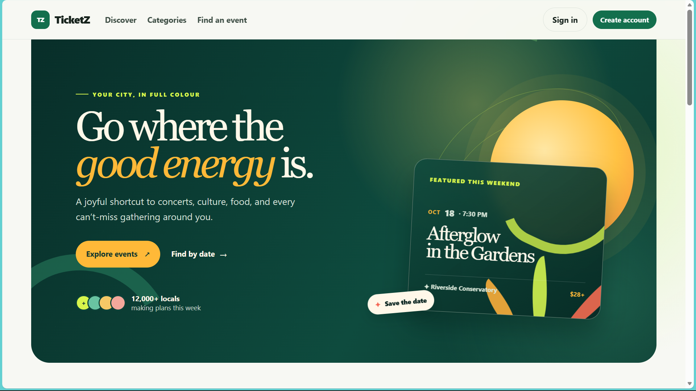
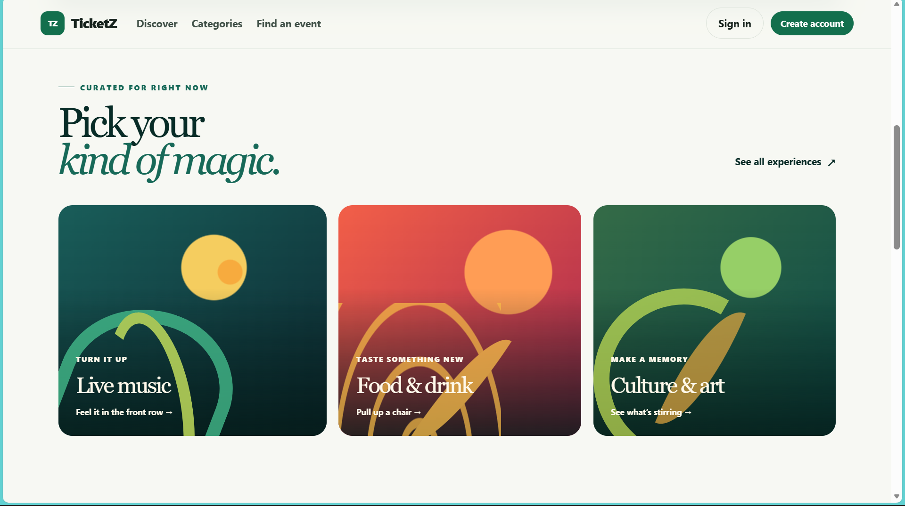
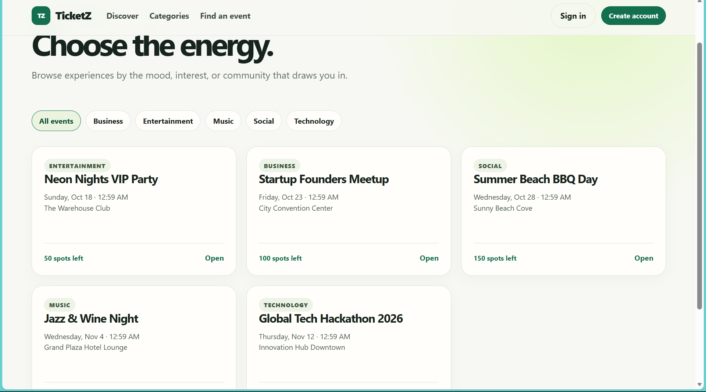
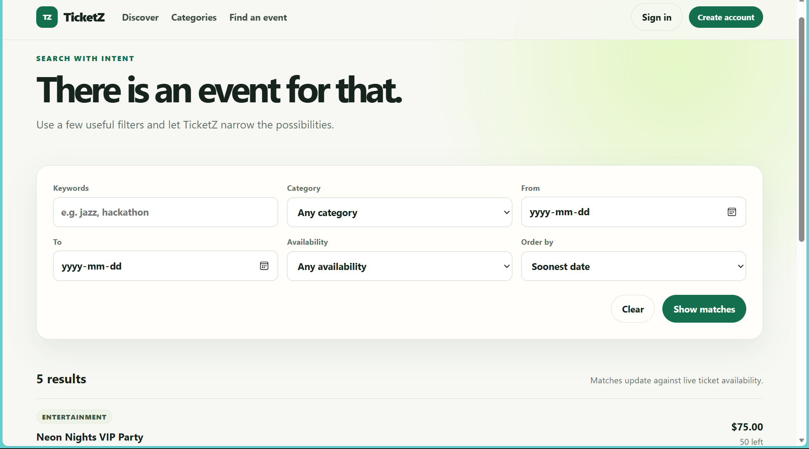
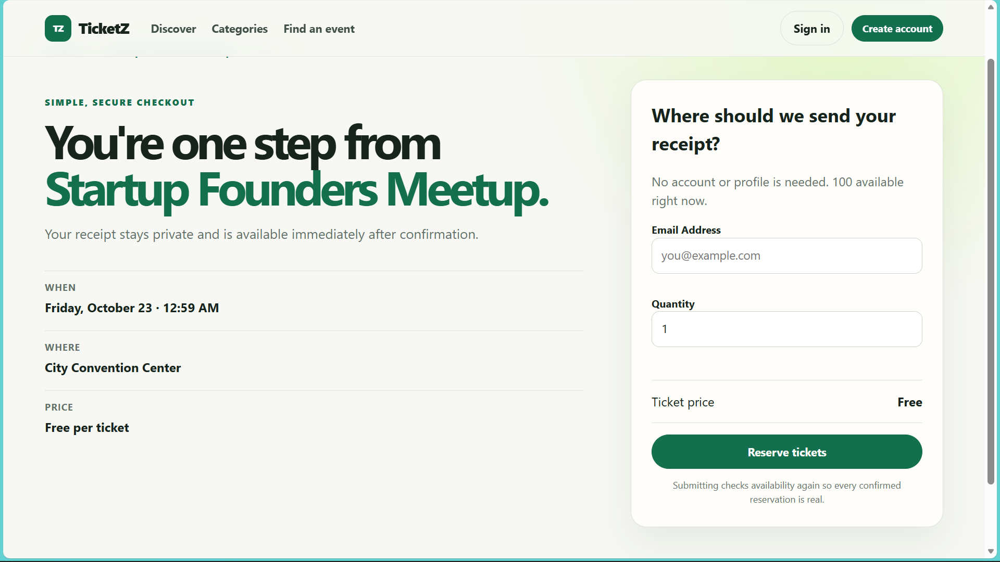

# TicketZ

TicketZ is an ASP.NET Core 9 event-discovery and ticket-reservation application. It gives guests a fast way to browse local events, filter what is available, reserve tickets with an email address, and access a protected receipt. Organizers and administrators can publish events and review sales.

## Highlights

- Browse seeded or organizer-created events by category.
- Search by keywords, category, date range, availability, and sort order.
- Reserve tickets without creating an account; checkout collects only email and quantity.
- Recheck inventory inside a database transaction before a reservation is confirmed.
- Issue protected receipt links for guest checkout.
- Use ASP.NET Core Identity roles for organizer/admin event management and sales views.
- Run with SQLite out of the box, with optional PostgreSQL configuration.

## Screenshots

These are live captures from the current application using its seeded development data. Event dates are generated relative to the date the application is first initialized.

### Festival-inspired home



### Discovery categories



### Event browsing



### Event search



### Guest checkout



## Technology

- .NET 9 / ASP.NET Core MVC and Razor views
- Entity Framework Core 9
- ASP.NET Core Identity
- SQLite by default; Npgsql provider included for PostgreSQL
- Serilog file logging

## Project layout

```text
TicketZ.Core/            Domain models and view models
TicketZ.Infrastructure/  EF Core context, data access, and seed data
TicketZ.Web/             MVC application, views, static assets, and Identity UI
```

## Run locally

### Prerequisites

- .NET 9 SDK

### Start the app

```bash
dotnet restore TicketZ.sln
dotnet run --project TicketZ.Web
```

On first run, TicketZ creates the local SQLite database, roles, and a small catalog of sample events.

### Build check

```bash
dotnet build TicketZ.sln --no-restore
```

## Configuration and local data

`TicketZ.Web/appsettings.json` is intentionally safe to commit: it uses a local SQLite connection and leaves the optional `SeedAdmin` email and password blank.

To use PostgreSQL, set `Database:Provider` to `PostgreSQL` and provide an appropriate `ConnectionStrings:DefaultConnection` value through a non-tracked environment-specific configuration source.
