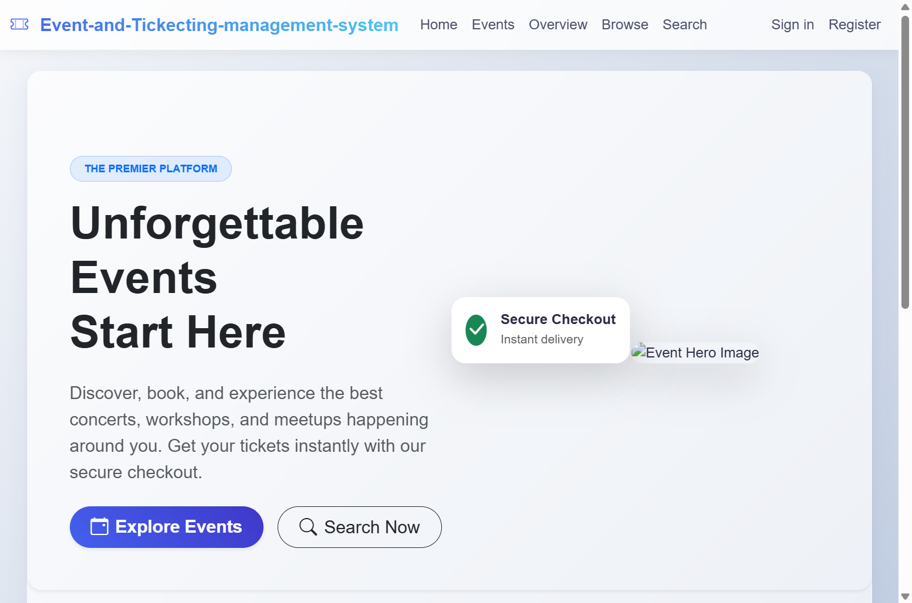
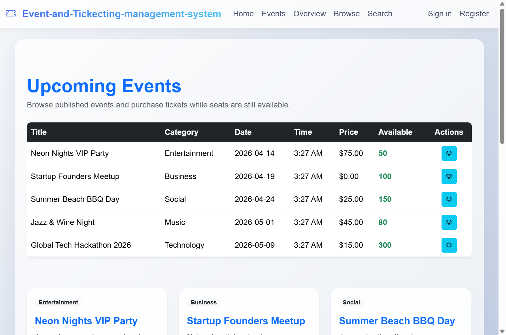

# Event-and-Ticketing-management-system





`Event-and-Ticketing-management-system` is an ASP.NET Core MVC application for publishing events, browsing upcoming schedules, searching by availability and date, and purchasing tickets through a guest-friendly checkout flow.

## What The App Does

- Publishes upcoming events with category, venue, date, pricing, capacity, and available ticket counts.
- Lets visitors browse all events, filter by category, and search by title, date range, price, and ticket status.
- Restricts event creation, editing, and deletion to `Admin` and `Organizer` roles.
- Supports ticket purchases without requiring a customer account.
- Generates private receipt links for completed purchases instead of exposing public confirmation pages.
- Gives admins and organizers a protected purchase summary view.

## Tech Stack

- ASP.NET Core MVC on .NET 9
- Entity Framework Core 9 with PostgreSQL
- ASP.NET Core Identity with roles
- Razor Views + Bootstrap 5
- Serilog file logging

## Security And Hardening

- Global anti-forgery validation for unsafe HTTP methods
- Stronger password and lockout defaults for Identity
- Hardened authentication and anti-forgery cookies with `HttpOnly`, `SameSite`, and secure transport policies
- HTTPS redirection and HSTS outside development
- Restrictive response headers including CSP, frame denial, referrer policy, and permissions policy
- Purchase receipts protected by a signed access token instead of public ID-only access
- Search flow fixed to use `AvailableTickets` and inclusive end-date filtering

## Local Setup

### 1. Prerequisites

- .NET 9 SDK
- PostgreSQL

### 2. Configure secrets

The app can read configuration from `appsettings.json`, but for real use you should move environment-specific values into user secrets or environment variables.

```bash
dotnet user-secrets init
dotnet user-secrets set "ConnectionStrings:DefaultConnection" "Host=localhost;Port=5432;Database=EventsDB;Username=postgres;Password=YOUR_PASSWORD;SSL Mode=Disable"
dotnet user-secrets set "SeedAdmin:Email" "admin@example.com"
dotnet user-secrets set "SeedAdmin:Password" "ChangeThis!123"
```

`SeedAdmin` is optional, but it is the fastest way to bootstrap an administrator account for event management.

### 3. Run the app

```bash
dotnet run
```

On startup the app:

- Applies pending Entity Framework migrations
- Seeds the `Admin`, `Organizer`, and `Attendee` roles
- Optionally creates an admin user if `SeedAdmin` values are present

Default launch profiles are configured for:

- `https://localhost:7146`
- `http://localhost:5207`

## Main User Flows

### Public visitors

- View the homepage, event list, overview, browse page, and search page
- Open event details
- Purchase available tickets and receive a private confirmation link

### Admins and organizers

- Sign in through ASP.NET Identity
- Create, edit, and delete events
- Review purchase summaries and receipt details

## Notes

- The app currently ships with a development-style connection string in [appsettings.json](appsettings.json). Before publishing or sharing the repo, move that value into user secrets or environment variables.
- Guest checkout remains public by design, but purchase summaries are now intentionally restricted to privileged roles.
- The confirmation page includes a lightweight confetti effect that respects reduced-motion preferences.
